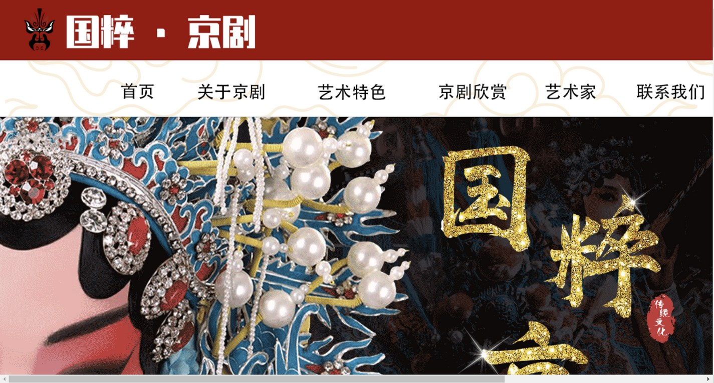

# 国粹 · 京剧

> 生旦净丑，唱念做打。

**以 PSD 切片还原京剧舞台美学的 12 页静态网站**  
毕业设计作品 · 使用 Claude Code 辅助开发与整理

[](https://developer.mozilla.org/zh-CN/docs/Web/HTML)
[](#技术特征)
[](#页面一览)
[](https://claude.com/claude-code)
[](#开发说明)

**[在线预览](https://morningluu.github.io/jingju-opera-website/)** · **[源码仓库](https://github.com/morningluu/jingju-opera-website)**



---

## 项目简介

京剧是中国的国粹，融合唱、念、做、打与文学、音乐、舞蹈、美术于一体。本项目以京剧文化为主题，围绕**发展历程、四大行当、声腔体系、伴奏体系、表演体系、脸谱艺术、舞台美术、经典欣赏、艺术家**等维度，完成 12 个主题页面。

这是一套典型的 **PSD 设计稿 → 图像切片 → HTML 表格布局** 作品。页面保留了 1921px 固定宽度、逐像素切片、悬停换图导航等早期网页设计方法，既是一份京剧文化展示，也是一份完整的“从视觉稿到网页”的课程设计档案。

## 页面一览

| 主题 | 页面文件 | 内容 |
| --- | --- | --- |
| 首页 | `首页/首页/首页.html` | 国粹主视觉、经典剧目、艺术家与文化导览 |
| 发展历程 | `关于京剧（发展历程）/关于京剧（发展历程）/发展历程.html` | 京剧形成、徽班进京、流派演变 |
| 四大行当 | `关于京剧（四大行当）/关于京剧（四大行当）/关于京剧（四大行当）.html` | 生、旦、净、丑的角色分工 |
| 声腔体系 | `关于京剧（声腔体系)/关于京剧（声腔体系）/关于京剧（声腔体系）.html` | 西皮、二黄与板式结构 |
| 伴奏体系 | `关于京剧（伴奏体系)/关于京剧（伴奏体系）/关于京剧（伴奏体系）.html` | 文场、武场与代表性乐器 |
| 表演体系 | `艺术特色（表演体系)/艺术特色（表演体系）/艺术特色（表演体系）.html` | 四功五法与程式化表演 |
| 脸谱艺术 | `艺术特色（脸谱艺术）/艺术特色（脸谱艺术）/艺术特色（脸谱艺术）.html` | 色彩寓意、谱式与人物性格 |
| 舞台美术 | `艺术特色（舞台美术）/艺术特色（舞台美术）/艺术特色（舞台美术）.html` | 一桌二椅、服装、砌末与空间 |
| 京剧欣赏 | `京剧欣赏/京剧欣赏/京剧欣赏/京剧欣赏.html` | 经典唱段与剧目导赏 |
| 艺术家 | `艺术家/艺术家/艺术家.html` | 名家风采与艺术成就 |
| 联系我们 | `联系我们/联系我们/联系我们.html` | 票友交流与联系信息 |
| 登录 | `登录/登录/登录切片.html` | 会员登录界面 |

> 根目录的 `index.html` 是本次整理新增的入口页，`pages.html` 汇总全部 12 个页面。原站导航主要覆盖 6 个一级栏目，其余专题页可从页面索引进入。

## 设计说明

- **主题色**：中国红 `#B01E23`、暗红 `#7A1115`、金色 `#D8B56A` 与米白纸色，形成京剧舞台的厚重感。
- **版式**：大字号书法标题、横向展开的戏曲头面特写、红色檐口与云纹分隔，强调“戏台 / 帷幕”的空间感。
- **图像**：以京剧剧照、头面、脸谱、服饰和舞台瞬间为主体，文字尽量让位于影像。
- **导航**：一级导航使用切片图片，悬停时切换为高亮 GIF，保留早期网页的交互质感。
- **内容组织**：从历史源流到行当、声腔、表演、脸谱、舞美，再到剧目与名家，构成由“史”到“艺”的知识路径。

## 技术特征

| 维度 | 实现 |
| --- | --- |
| 页面结构 | 12 个独立 HTML 页面，使用 `<table>` 精确还原设计稿 |
| 图像 | 每个栏目独立 `images/` 目录，共约 700 个 GIF / JPG / PNG 切片 |
| 样式 | 主要依赖图片本身与少量内联属性，无独立 CSS 文件 |
| 交互 | 图片悬停换图导航，无 JavaScript 框架 |
| 宽度 | 固定 1921px 桌面版式，未做移动端重排 |
| 字体 | 标题文字已栅格化为图片，保证跨设备视觉一致 |

### 本次整理所做的改动

1. 新增根目录入口页 `index.html` 与全站页面索引 `pages.html`，方便 GitHub Pages 访问。
2. 修正「京剧欣赏」页面中 6 处导航相对路径层级，使返回首页等链接可用。
3. 移除未被任何页面引用的外层重复图片目录，仅保留实际使用的页面文件夹与切片素材。
4. 增加 `README.md`、预览图、`.gitignore` 与 `.nojekyll`，不改动原页面的视觉内容。

## 目录结构

```text
jingju-opera-website/
├── index.html                  # 新增：入口页
├── pages.html                  # 新增：12 页索引
├── 首页/
│   └── 首页/
│       ├── 首页.html
│       └── images/
├── 关于京剧（发展历程）/
├── 关于京剧（四大行当）/
├── 关于京剧（声腔体系)/
├── 关于京剧（伴奏体系)/
├── 艺术特色（表演体系)/
├── 艺术特色（脸谱艺术）/
├── 艺术特色（舞台美术）/
├── 京剧欣赏/
├── 艺术家/
├── 联系我们/
├── 登录/
├── preview.jpg
└── README.md
```

> 目录名保留了原设计稿中的中英文括号差异（如 `（声腔体系)`），以保证原有相对链接不变。

## 本地运行

```bash
# 在项目根目录执行
python -m http.server 8000
```

访问 <http://localhost:8000>，从入口页进入首页。由于原稿是固定宽度切片页面，建议使用 **1440px 以上桌面浏览器** 浏览；窗口较窄时可横向滚动查看完整画面。

## 开发说明

- **项目性质**：毕业设计 / 京剧文化主题静态网站
- **制作方式**：依据 PSD 设计稿完成图像切片与 HTML 表格还原；本次整理、入口页和页面索引使用 **Claude Code** 辅助完成
- **技术定位**：展示“设计稿 → 切片 → 网页”的传统制作流程，不等同于现代响应式前端模板
- **浏览器支持**：Chrome、Edge、Firefox、Safari 桌面版

## 素材与声明

本项目用于毕业设计与传统文化展示。京剧剧照、头面、脸谱及相关图片仅作学习交流使用，版权归原作者或相关机构所有；如有侵权请联系删除。页面中的联系与登录信息均为展示内容，不具备真实业务功能。

## 作者

[@morningluu](https://github.com/morningluu)
